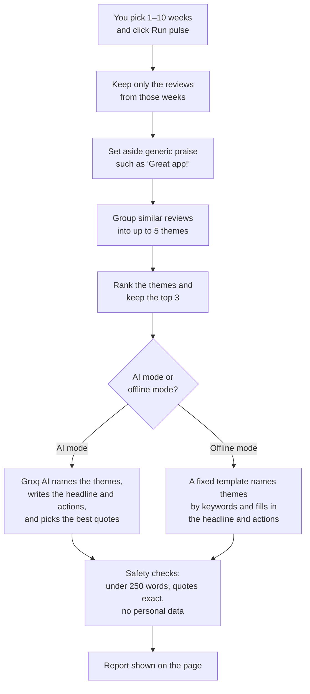
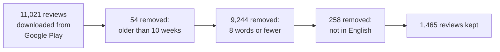
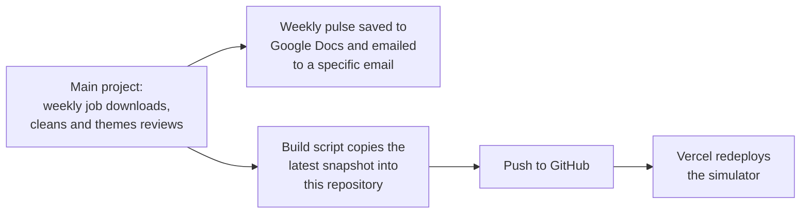

# Groww Review Pulse Simulator

**Turn thousands of Google Play reviews of the Groww app into a one-page summary in seconds.**

Choose how many recent weeks of reviews to look at (1 to 10) and click **Run pulse**. The app reads every review from that period, finds what people talk about most, and shows:

| Section | What you see |
| --- | --- |
| **Summary** | How many reviews were used, how many weeks, and the date range, plus a one-line headline |
| **Top themes** | The 3 biggest topics, each with its share of reviews, average star rating and change since the previous week |
| **What users say** | One real quote per theme, copied word for word from a review |
| **Action items** | 3 concrete next steps, each with an owner: Product, Support or Growth |

Who it's for: product, support and growth teams who want to know what users are saying without reading every review.

## Features

- **Visual week picker:** 10 bars, one per week, each as tall as that week's review count. Click a bar to choose "the last N weeks", or type a number from 1 to 10. Before you run anything, the page shows the dates and how many reviews your choice covers.
- **AI mode or offline mode:** AI mode writes natural theme names, a headline and specific actions. Offline mode needs no API key and returns a template-based report in under a second.
- **Live progress:** while the report is being made, the page shows the step it's on.
- **Easy-to-scan report:** each theme has its own colour, used again on its quote and its action item, so you can see at a glance which ones belong together. Star ratings, share bars and week-over-week arrows show the numbers visually.
- **Low-confidence warning:** if a window has fewer than 30 reviews, the report says so.
- **Copy as Markdown:** one click copies the whole report, ready to paste into a doc, email or chat.
- **Light and dark mode:** follows your system setting by default; the toggle at the top right switches it and remembers your choice.
- **Works on phones:** the layout adapts down to small screens.
- **Fast repeats:** asking for the same number of weeks again returns the saved result instantly.
- **Clear errors:** if something fails, the page says what went wrong and offers **Try again**.

## How a report is made



Numbers are never made up by the AI. Review counts, percentages, star ratings and week-over-week changes are all calculated from the reviews themselves. Quotes are always copied exactly from real reviews.

### AI mode vs offline mode

The **Offline mode** checkbox on the page decides who writes the words.

| | AI mode (default) | Offline mode |
| --- | --- | --- |
| Theme names | Natural, e.g. "Customer Support Issues" | Keywords, e.g. "Support / Customer / Service" |
| Headline and actions | Written for this data | Same fixed pattern every time |
| Numbers and quotes | From the reviews | From the reviews |
| Speed | About 10–17 seconds | Under 1 second |
| Needs a Groq API key | Yes | No |

Use AI mode for a report you'll share, and offline mode for a quick, free look at the numbers.

## The review data

The current snapshot was downloaded on **4 October 2026** and covers **26 July to 3 October 2026** (10 weeks).

### From 11,021 reviews to 1,465



| Step | What was done | Reviews left |
| --- | --- | ---: |
| Download | Public reviews of the Groww app from the Google Play Store (no login, no private data) | 11,021 |
| Date window | Kept only the last 10 weeks before the download date (54 removed) | 10,967 |
| Too short | Removed reviews of 8 words or fewer, such as "nice app" or "good", which say nothing specific (9,244 removed) | 1,723 |
| Language | Removed non-English and mixed Hindi-English reviews (258 removed) | 1,465 |
| Duplicates | Checked for repeated reviews (none found) | 1,465 |
| Personal details | Masked anything that could identify someone: emails, phone numbers, PAN, Aadhaar and account numbers, UPI IDs and names. In this snapshot, 1 ID and 1 name were masked. Reviewer usernames are never kept, and each review gets a new short code instead of its Play Store ID | 1,465 |

Of the 1,465 kept reviews, **120 are generic praise**: 4 or 5 stars, 12 words or fewer, and no specific topic such as KYC, charges, crashes or support (for example "best app for beginners"; average rating 4.9). These are counted in the total but set aside before grouping, so they don't drown out the real issues. That leaves **1,345 reviews** that are grouped into themes.

Each review is also pre-converted into an **embedding**: a list of numbers that captures its meaning, so similar reviews end up close together. These are saved in `data/themes/`, which lets the app group reviews without loading a large AI model.

## Themes

Themes are worked out fresh for whichever weeks you choose, so the names and numbers on the page change with your selection. For the full 10 weeks, the reviews group into these 5 themes:

| Rank | Theme | Reviews | Share | Avg rating | What users talk about |
| :---: | --- | ---: | ---: | :---: | --- |
| 1 | App Performance & Bugs | 244 | 18% | 1.9 ★ | Crashes, chart lag, freezing and glitches after updates |
| 2 | Customer Support Issues | 193 | 14% | 1.2 ★ | Hard to reach support, slow replies, unresolved tickets |
| 3 | UI/UX and Feature Changes | 314 | 23% | 3.1 ★ | UI redesigns, missing buttons, confusing layouts, feature requests |
| 4 | Brokerage and Charges | 161 | 12% | 2.0 ★ | High brokerage, hidden fees, extra charges on orders and withdrawals |
| 5 | KYC and Account Onboarding | 52 | 4% | 1.8 ★ | KYC verification, document uploads, account creation |

Another 381 reviews didn't fit any single theme clearly and are counted as "other".

**Why isn't the largest theme ranked first?** Ranking weighs how many people mention a theme *and* how unhappy they are: score = share of reviews × (5 − average rating). "UI/UX and Feature Changes" is the most discussed (23%), but its average rating of 3.1 is much higher than "App Performance & Bugs" (1.9) or "Customer Support Issues" (1.2), so those two rank above it. The report shows the top 3.

## About this project

This simulator is the interactive part of a larger project. Every week, the main project:

1. downloads the newest Play Store reviews;
2. cleans them as described above;
3. groups them into themes;
4. writes the one-page pulse;
5. saves it as a Google Doc and emails it to a specific email address.

This repository holds only the simulator. It never sends email or creates documents; it only shows results on the page.



## Tech stack

| Layer | Technology | Used for |
| --- | --- | --- |
| **Frontend** | HTML, CSS and plain JavaScript (no framework, no build step) | The week picker, progress steps and report |
| | Google Fonts: Schibsted Grotesk and Newsreader | Interface text, and the headline and quotes |
| **Backend** | Python 3.12, [FastAPI](https://fastapi.tiangolo.com), Pydantic | The web API and input checks |
| **Grouping reviews** | Sentence embeddings from `all-MiniLM-L6-v2` ([sentence-transformers](https://www.sbert.net)), computed in advance | Turning each review into numbers that capture its meaning |
| | [scikit-learn](https://scikit-learn.org) k-means and NumPy | Grouping similar reviews into themes |
| | scikit-learn TF-IDF | Keyword theme names in offline mode |
| **AI** | [Groq](https://groq.com) API with the `openai/gpt-oss-120b` model, using structured JSON output | Naming themes, writing the headline, summaries and actions, and choosing quotes |
| **Settings** | YAML (`config.yaml`) | Number of themes, word limit, AI model |
| **Hosting** | [Vercel](https://vercel.com): one Python function for the API, CDN for the page | Running the simulator online |

The main project, which feeds this repository, also uses `google-play-scraper` to download reviews, the Model Context Protocol (MCP) to create Google Docs and send email, macOS `launchd` to run every week, and `pytest` for its tests.

## Repository layout

| Path | What it is |
| --- | --- |
| `index.py` | The starting point Vercel runs |
| `public/` | The web page: `index.html`, `static/styles.css`, `static/app.js` |
| `src/api/` | The web API (`server.py`) and the simulator steps (`simulate.py`) |
| `src/themes/` | Grouping reviews into themes and naming them |
| `src/pulse/` | Choosing quotes and writing the report |
| `src/validate.py`, `src/clean/` | The safety checks: length, exact quotes, personal data |
| `data/` | The review snapshot and its embeddings |
| `config.yaml` | Settings: number of themes, word limit, AI model |
| `vercel.json`, `.python-version`, `requirements.txt` | Vercel settings, Python 3.12, and the libraries used |

## API

The page talks to two endpoints. You can call them directly too.

| Method | Path | What it does |
| --- | --- | --- |
| `GET` | `/api/snapshot` | Returns the snapshot date and how many reviews came in each week |
| `POST` | `/api/pulse` | Runs the pulse. Body: `{"weeks": 4, "use_llm": true}`. Returns the full report as JSON |

`weeks` must be a whole number from 1 to 10. Anything else is rejected with error 422.

## Deploy your own copy on Vercel

1. Go to [vercel.com/new](https://vercel.com/new) and import this repository. Vercel detects it as a **FastAPI** app. Keep the root directory as `./`.
2. Add these environment variables:

   | Name | Value | Why |
   | --- | --- | --- |
   | `GROQ_API_KEY` | your key from [console.groq.com](https://console.groq.com) | The AI that names themes and writes the report |
   | `PULSE_SYNC` | `1` | Runs each pulse inside a single request, which Vercel needs |
   | `PULSE_NO_ENCODER` | `1` | Uses only the saved embeddings and never loads a large AI model |

3. Click **Deploy**.
4. Recommended: turn on **Settings → Deployment Protection**. Every AI run uses your Groq quota, so you may not want the link to be public.

The first run after the site has been idle takes about 15 seconds while it starts up. Later runs are faster.

## Run it on your computer

```
python3.12 -m venv .venv && source .venv/bin/activate
pip install -r requirements.txt uvicorn
export GROQ_API_KEY=your-key PULSE_SYNC=1 PULSE_NO_ENCODER=1
uvicorn index:app --port 8000
```

This starts the API at `http://127.0.0.1:8000`. The page itself (`public/`) is normally served by Vercel. To try page and API together on your computer, use the main project's `python -m src.api` instead.

## Known limitations

- **Short windows with AI mode can time out on Vercel.** With 1–2 weeks of reviews, the first grouping is often not clear enough, and the app asks the AI to sort every review one batch at a time. On Groq's free tier this can take several minutes, longer than Vercel's 60-second limit. Choose 4 or more weeks, or use offline mode.
- **The AI occasionally returns a malformed answer.** The run then shows an error; clicking **Try again** usually works.
- **The data is a snapshot.** It only changes when the main project fetches new reviews and this repository is rebuilt.

## Updating this repository

This repository is generated, so don't edit files here by hand. Make changes in the main project, then:

1. Run `scripts/build_vercel.sh` there. It copies the latest code and review snapshot into this folder.
2. Commit and push. Vercel redeploys automatically.
